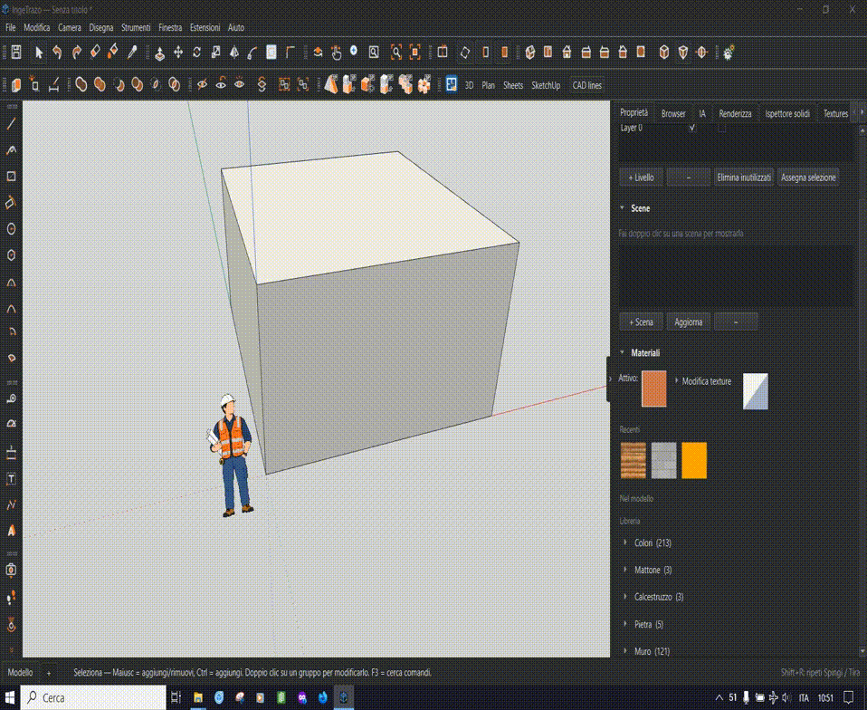

# IngeTrazo - Same Mat
IngeTrazo Extension - Selects faces with the same material, allowing you to color them or apply a different material; it also automatically applies the material to the back face. Languages: ENG + ITA

### Dependencies
IngeTrazo: https://github.com/ingelibre/ingetrazo

Blender (for integrate render): https://www.blender.org/download/

### Step
1) Select a face
2) Click “Connected” to select all connected faces made of the same material
3) Click “Color” to apply a new color; if you already have another material applied to the model, you can choose that one as well

### Tutorial

